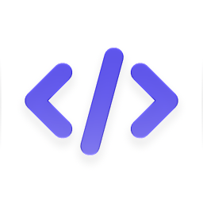

# task-decomposition — ролевой подход к делегированию в MiniMax Code



Публичный репозиторий содержит только **настройки агентно-ролевого подхода**:
36 специализированных субагентов, скилл декомпозиции и скрипт установки в профиль.
Роль = имя агента, модель роли задана в настройках самого агента.

Всё остальное (роутер, профиль, скрипты, документация) живёт в приватном
репозитории и в этот пакет не входит.

## Что внутри

| Путь | Что это |
| --- | --- |
| `agents/<роль>/agent.md` | 36 ролевых субагентов: промпт, `model:`, при необходимости `effort:` |
| `agents/<роль>/avatar.png` | Иконка роли (в панели субагентов показывается своя) |
| `skills/task-decomposition/SKILL.md` | Скилл: когда и как разложить задачу на зоны |
| `scripts/install_roles.py` | Установка ролей и скилла в профиль MiniMax Code |
| `scripts/check_role_agents.py` | Проверка промптов ролей (структура, язык, JSON-контракт, иконка) |
| `E2E-PROMPTS.md` | Промпты проверки: роли выбираются сами, без явного вызова агента |

## Как это работает

1. Скилл `task-decomposition` подсказывает, когда задача распадается на независимые части.
2. Оркестратор выбирает роль по типу результата зоны и вызывает её через
   `task` с `agent_name="<роль>"` — голым именем агента из реестра среды.
3. Модель роли задана во фронтматтере агента (`model:`) и применяется рантаймом
   MiniMax Code. Никакого роутера, хуков и собственного кода в рантайме нет.
4. Если модели нет в каталоге рантайма, вызов падает явно с
   `MODEL_SELECTION_INVALID` — молчаливой подмены исполнителя не происходит.

Почему именно голое имя: при вызове через имя с префиксом (например
`plugin:role`) дочерняя сессия получает встроенного исполнителя — личность роли
теряется, и в панели субагентов вместо роли показывается встроенный агент.

## Установка

```powershell
git clone https://github.com/alexblag023/minimax-code-customizations.git
cd minimax-code-customizations
python -X utf8 scripts/install_roles.py
```

Скрипт кладёт 36 агентов в `<DATA_DIR>/agents/<роль>/` (промпт и иконка) и скилл
в `<DATA_DIR>/skills/task-decomposition/`. Больше ничего не требуется: ни Python на
рабочей машине, ни ключей, ни сети.

Проверить без записи:

```powershell
python -X utf8 scripts/install_roles.py --check
```

После установки откройте **новую** сессию MiniMax Code: список агентов и
каталог скиллов фиксируется на старте сессии.

## Смена модели роли

Модель меняется руками в настройках агента — одна строка в
`agents/<роль>/agent.md`:

```yaml
---
name: locate
model: custom_provider:openai-codex/gpt-6-luna
effort: high
---
```

После правки переустановите роли:

```powershell
python -X utf8 scripts/install_roles.py
```

Установщик проверяет модель по каталогу рантайма (`config.yaml` профиля) и
предупреждает, если модели в каталоге нет. `effort` проверяется по списку
`effortOptions` самой модели.

## Требования

- MiniMax Code Desktop 3.1.2+ (для субагентов).
- Python 3.9+ — только на машине, где ставится набор. В самой работе MCode
  Python не нужен: ни в рантайме, ни в скилле.

## Проверки

```powershell
python -X utf8 scripts/check_role_agents.py
python -X utf8 scripts/install_roles.py --check
```

## Лицензия и использование

Промпты ролей можно свободно использовать и дорабатывать под свои задачи:
правьте `agents/<роль>/agent.md`, проверяйте `scripts/check_role_agents.py` и
переустанавливайте роли.