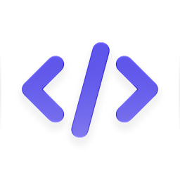

# Role-based subagents in MiniMax Code



The public repository contains only the **agent-role approach settings**:
36 specialized subagents and a profile installation script.
A role is the agent's name; the model is chosen by MiniMax Code itself (AUTO).

Everything else (router, profile, scripts, documentation) lives in the private
repository and is not part of this package.

## Contents

| Path | Contents |
| --- | --- |
| `agents/<role>/agent.md` | 36 role-specific subagents: prompt and description |
| `agents/<role>/avatar.png` | Role icon (each subagent has its own icon in the panel) |
| `scripts/install_roles.py` | Installs roles in the MiniMax Code profile |
| `scripts/check_role_agents.py` | Checks role prompts (structure, language, JSON contract, icon) |
| `E2E-PROMPTS.md` | Test prompts: roles are selected automatically, without explicitly invoking an agent |

## How it works

1. The orchestrator sees the role list in the environment registry and picks a role by the
   'Use when' clause in its description.
2. It invokes it through `task` with `agent_name="<role>"` — the bare agent name.
3. The model is NOT pinned in the agent file: the role runs in AUTO mode, and MiniMax Code
   resolves the model itself. There is no router, no hook, and no custom runtime code.
4. MCode decides on its own whether an agent is needed at all and which one fits.

Why use the bare name: when called with a prefixed name (for example,
`plugin:role`), the child session gets the built-in executor — the role's identity
is lost, and the panel shows the built-in agent instead of the role.

## Installation

```powershell
git clone https://github.com/alexblag023/minimax-code-customizations.git
cd minimax-code-customizations
python -X utf8 scripts/install_roles.py
```

The script installs 36 agents in `<DATA_DIR>/agents/<role>/` (prompt and icon). Nothing else
is required: no Python on the work machine, no keys, and no network.

To check without writing:

```powershell
python -X utf8 scripts/install_roles.py --check
```

After installation, open a **new** MiniMax Code session: the agent list is loaded when
the session starts.

## Pinning a model (optional)

AUTO is the default and the recommended mode. To pin a model for one role, add one line
in `agents/<role>/agent.md`:

```yaml
---
name: locate
model: custom_provider:openai-codex/gpt-6-luna
effort: high
---
```

After editing, reinstall the roles:

```powershell
python -X utf8 scripts/install_roles.py
```

A pinned model must exist in the runtime catalog (the profile's `config.yaml`), otherwise
the call fails explicitly with `MODEL_SELECTION_INVALID` — the executor is not silently
replaced. `effort` is checked against the model's `effortOptions` list.

## Requirements

- MiniMax Code Desktop 3.1.2+ (for subagents).
- Python 3.9+ is required only on the machine where the set is installed. Python is not
  needed to use MCode.

## Checks

```powershell
python -X utf8 scripts/check_role_agents.py
python -X utf8 scripts/install_roles.py --check
```

## License and use

Role prompts may be freely used and adapted for your own needs:
edit `agents/<role>/agent.md`, run `scripts/check_role_agents.py`, and
reinstall the roles.
